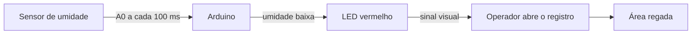

# Sistema de Irrigação com Arduino

Monitoramento de **umidade do solo** a cada **100 ms**.  
Quando a leitura fica **abaixo do limiar**, o **LED vermelho acende** para o operador **abrir o registro** e regar a área.

> **Linguagem:** o firmware do Arduino é **C/C++** (arquivo `.ino`).  
> Placas AVR (Uno/Nano) não executam C#. O projeto foi montado na linguagem nativa do Arduino.

---

## Como funciona



| Estado | LED | Ação do operador |
|--------|-----|------------------|
| Umidade **abaixo** do limiar | Aceso | Abrir o registro e regar |
| Umidade **OK** | Apagado | Manter registro fechado |

---

## Testar sem Arduino físico

Há um **simulador em C#** (executável) com a mesma lógica do firmware:

```bash
./dist/IrrigacaoSimulador
```

Controles: `↑/↓` umidade · `R` regar · `A` automático · `Q` sair  

Guia: [`docs/07-simulador.md`](docs/07-simulador.md)

---

## Estrutura do projeto

```
arduino_irrigacao/
├── README.md                 ← você está aqui
├── .gitignore
├── irrigacao/
│   └── irrigacao.ino         ← firmware Arduino (C/C++)
├── simulador/
│   └── IrrigacaoSimulador/   ← código C# do simulador
├── dist/
│   └── IrrigacaoSimulador    ← executável pronto (macOS ARM)
└── docs/
    ├── README.md             ← índice da documentação
    ├── 01-visao-geral.md
    ├── 02-materiais.md
    ├── 03-esquema-eletrico.md
    ├── 04-instalacao.md
    ├── 05-uso.md
    ├── 06-calibracao.md
    ├── 07-simulador.md
    └── imagens/
        └── esquema-ascii.txt
```

---

## Ligação rápida

```
Sensor VCC → 5V
Sensor GND → GND
Sensor AO  → A0

D8 → [220 Ω] → LED (+) → LED (−) → GND
```

Detalhes e diagramas: [`docs/03-esquema-eletrico.md`](docs/03-esquema-eletrico.md)

---

## Compilar e gravar

Com o `arduino-cli` (já instalado em `~/.local/bin`):

```bash
export PATH="$HOME/.local/bin:$PATH"
cd /Users/joaovitorcamargo/www/arduino_irrigacao

# Compilar (Arduino Uno)
arduino-cli compile --fqbn arduino:avr:uno irrigacao

# Ver porta USB
arduino-cli board list

# Gravar (troque a porta)
arduino-cli upload -p /dev/cu.usbmodem14101 --fqbn arduino:avr:uno irrigacao

# Monitor Serial
arduino-cli monitor -p /dev/cu.usbmodem14101 -c baudrate=9600
```

Guia completo: [`docs/04-instalacao.md`](docs/04-instalacao.md)

---

## Parâmetros principais

No arquivo `irrigacao/irrigacao.ino`:

```cpp
const int LIMIAR_UMIDADE_PCT = 40;           // abaixo disso → LED acende
const unsigned long INTERVALO_LEITURA_MS = 100;
const int SENSOR_SECO = 900;                 // calibração
const int SENSOR_UMIDO = 300;
```

Como calibrar: [`docs/06-calibracao.md`](docs/06-calibracao.md)

---

## Documentação

Comece por: **[`docs/README.md`](docs/README.md)**

1. [Visão geral](docs/01-visao-geral.md)  
2. [Materiais](docs/02-materiais.md)  
3. [Esquema elétrico](docs/03-esquema-eletrico.md)  
4. [Instalação](docs/04-instalacao.md)  
5. [Como usar](docs/05-uso.md)  
6. [Calibração](docs/06-calibracao.md)  
7. [Simulador (sem hardware)](docs/07-simulador.md)

---

## Materiais (resumo)

- Arduino Uno ou Nano  
- Sensor de umidade do solo  
- LED vermelho + resistor 220 Ω  
- Protoboard e jumpers  

Lista completa: [`docs/02-materiais.md`](docs/02-materiais.md)

---

## Autor do repositório (git local)

Configurado **somente neste projeto**:

- Nome: **Dario Miguel**  
- E-mail: **dariomiguelparre@gmail.com**
