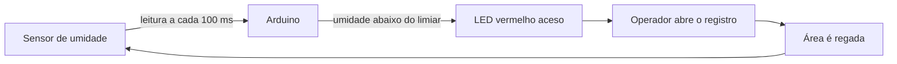
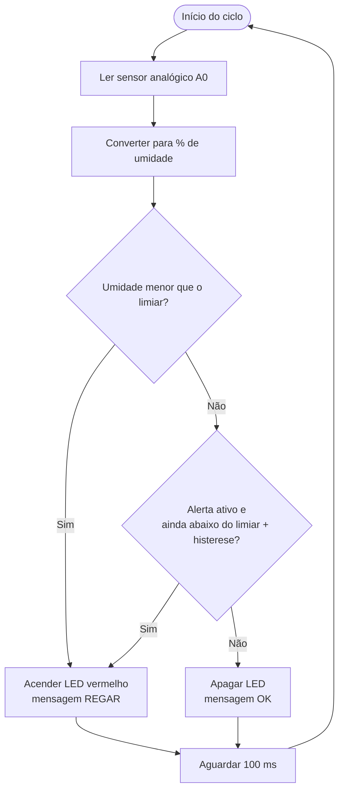

# Visão geral do sistema

## O que este projeto faz

O Arduino lê o **sensor de umidade do solo** a cada **100 milissegundos**.  
Se a umidade ficar **abaixo do limiar** configurado no código, o **LED vermelho acende**.

O LED é o sinal visual para o **operador abrir o registro** e regar a área monitorada.  
Quando a umidade volta a um nível seguro, o LED apaga.



## Fluxo de decisão



## Papel de cada parte

| Parte | Função |
|-------|--------|
| Sensor de umidade | Mede o quão seco/úmido está o solo |
| Arduino | Lê, compara com o limiar e decide o alerta |
| LED vermelho | Avisa o operador que precisa regar |
| Operador + registro | Ação humana de abrir a água |

## O que **não** está automatizado

Neste projeto o **registro é manual**: o Arduino **não** aciona bomba nem válvula solenóide.  
Só monitora e sinaliza com o LED. Isso atende ao requisito e evita riscos elétricos com 110/220 V sem isolamento adequado.

## Testar sem hardware

Sem Arduino físico, use o simulador C#: [`07-simulador.md`](07-simulador.md)

```bash
./dist/IrrigacaoSimulador
```

## Próximos passos

1. [Materiais](02-materiais.md)
2. [Esquema elétrico](03-esquema-eletrico.md)
3. [Instalação e gravação](04-instalacao.md)
4. [Como usar](05-uso.md)
5. [Calibração](06-calibracao.md)
6. [Simulador](07-simulador.md)
