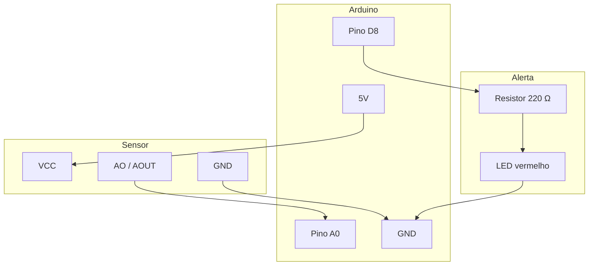

# Esquema elétrico

## Diagrama de conexão



## Tabela de pinos

| Componente | Terminal | Arduino |
|------------|----------|---------|
| Sensor | VCC | 5V |
| Sensor | GND | GND |
| Sensor | AO / AOUT | A0 |
| Resistor | um lado | D8 |
| Resistor | outro lado | Ânodo do LED (+) |
| LED | Cátodo (−) | GND |

## Versão ASCII (para impressão)

Veja o arquivo completo em [`imagens/esquema-ascii.txt`](imagens/esquema-ascii.txt).

```
        +5V ---- VCC (sensor)
        GND ---- GND (sensor)
         A0 ---- AO  (sensor)

        D8 --[220Ω]--|>|-- GND
                     LED
```

## Cuidados

1. **Resistor no LED** — sem ele, o LED ou a porta digital podem queimar.
2. **Terra comum** — sensor, LED e Arduino devem compartilhar o mesmo GND.
3. **Sensor no solo** — enterre só a ponta sensora; deixe o módulo eletrônico fora da água.
4. **Cabos longos** — se o cabo do sensor passar de ~1 m, prefira capacitivo ou blindagem.

## Polaridade do LED

```
D8 ──► resistor ──► ânodo (perna longa) ──► cátodo (perna curta / flat) ──► GND
```
