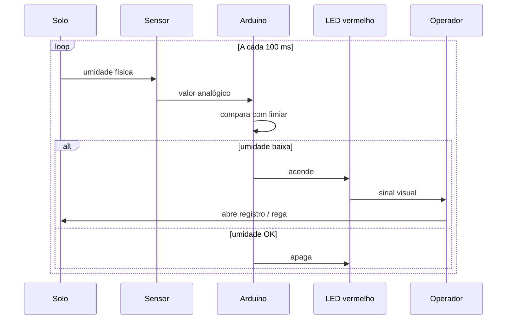

# Como usar no dia a dia

## Passo a passo operacional

1. **Monte** o circuito conforme [`03-esquema-eletrico.md`](03-esquema-eletrico.md).
2. **Alimente** o Arduino (USB ou fonte).
3. **Enterre** a ponta do sensor na área a monitorar.
4. Observe o **LED vermelho**:
   - **Aceso** → solo seco demais → **abra o registro** e regue.
   - **Apagado** → umidade OK → mantenha o registro fechado.
5. Depois de regar, aguarde alguns segundos. Quando a umidade subir, o LED apaga.



## Leitura no Monitor Serial

Formato das linhas:

```
Bruto   Umidade%   Alerta
812     22         REGAR
450     68         OK
```

| Coluna | Significado |
|--------|-------------|
| Bruto | ADC 0–1023 |
| Umidade% | Estimativa 0–100 após calibração |
| Alerta | `REGAR` (LED on) ou `OK` (LED off) |

## Boas práticas

- Não deixe o módulo eletrônico do sensor enterrado na água.
- Limpe o sensor resistivo com frequência (corrosão).
- Recalibre se trocar de sensor ou de tipo de solo ([`06-calibracao.md`](06-calibracao.md)).
- Se o LED piscar perto do limiar, aumente `HISTERESE_PCT` no código.

## Solução rápida de problemas

| Sintoma | Possível causa | O que fazer |
|---------|----------------|-------------|
| LED nunca acende | Pino errado / LED invertido | Conferir D8 e polaridade |
| Sempre `REGAR` | Calibração ruim / sensor seco | Calibrar `SENSOR_SECO` / `SENSOR_UMIDO` |
| Leitura travada | Cabo solto em A0 | Refazer jumpers |
| Porta USB não aparece | Driver CH340 / cabo só carga | Trocar cabo / instalar driver |
