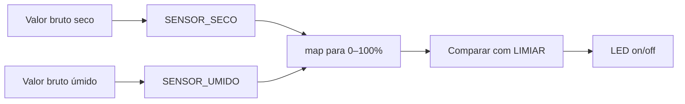

# Calibração do sensor

Cada sensor (e cada solo) entrega valores brutos diferentes. Sem calibração, a % de umidade fica imprecisa.

## Objetivo

Descobrir dois números no Monitor Serial:

| Constante | Quando medir |
|-----------|--------------|
| `SENSOR_SECO` | Sensor no ar ou solo bem seco |
| `SENSOR_UMIDO` | Sensor em solo bem molhado (ou na água, com cuidado) |

## Procedimento

1. Grave o firmware e abra o Monitor Serial (9600 baud).
2. Deixe o sensor **seco** por 10–20 segundos. Anote o valor da coluna **Bruto** → use como `SENSOR_SECO`.
3. Molhe bem o solo (ou mergulhe só a ponta). Anote o **Bruto** → use como `SENSOR_UMIDO`.
4. Edite `irrigacao/irrigacao.ino`:

```cpp
const int SENSOR_SECO = 900;   // seu valor seco
const int SENSOR_UMIDO = 300;  // seu valor úmido
```

5. Compile, grave de novo e teste.

## Escolher o limiar

`LIMIAR_UMIDADE_PCT` é o ponto em que o LED acende.

| Cultura / uso | Sugestão inicial |
|---------------|------------------|
| Solo geral / vasos | 35–45% |
| Solo que seca rápido | 45–55% |
| Menos irrigação | 25–35% |

Exemplo:

```cpp
const int LIMIAR_UMIDADE_PCT = 40;
```

## Histerese

Para o LED não piscar quando a umidade oscila perto do limiar:

```cpp
const int HISTERESE_PCT = 3;
```

O alerta **liga** abaixo de 40% e só **desliga** em 43% ou mais (com limiar 40 e histerese 3).

## Conferência visual


